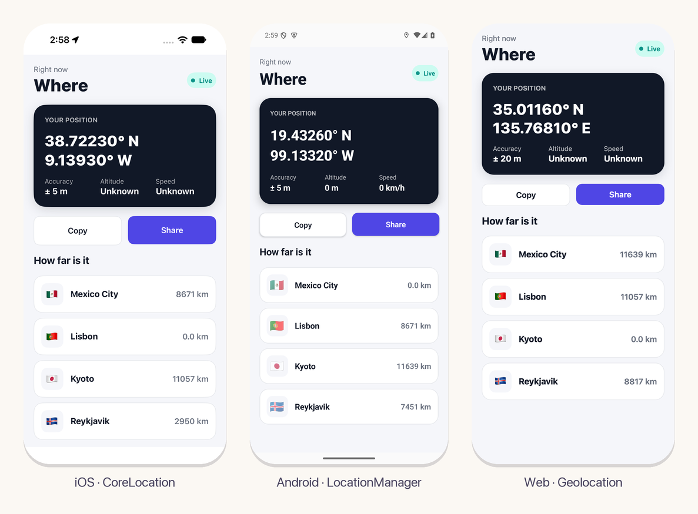

<p align="center">
  
</p>

<h2 align="center">location</h2>
<p align="center">Where the device is, for apps on eskiu-lang/ui.</p>
<p align="center"><sub>Part of the <a href="https://github.com/eskiu-lang">Eskiu</a> project</sub></p>
<p align="center">
  <a href="https://eskiu-lang.org/ui.html">eskiu-lang.org/ui</a> &nbsp;&middot;&nbsp;
  <a href="#use-it">Use it</a> &nbsp;&middot;&nbsp;
  <a href="examples/where">Example</a> &nbsp;&middot;&nbsp;
  <a href="https://github.com/eskiu-lang/ui">ui</a>
</p>

<p align="center">
  <a href="https://github.com/eskiu-lang/ui-location/actions/workflows/ci.yml"></a>
  
  <a href="LICENSE"></a>
</p>

---

A component calls `use_location` and gets the latest position while it is mounted; the
platform's own service measures it: CoreLocation on iOS, `LocationManager` on Android and
`navigator.geolocation` on the web. The first use asks the user for permission.



## Add it

In an app made with `ui new`:

```bash
eskiuc add location --git https://github.com/eskiu-lang/ui-location --rev v0.1.2
```

The package brings what each platform needs through its `ui.toml`: the CoreLocation framework
and a usage text on iOS, the location permissions on Android. Put your own text in the app's
`ui.toml`, which wins over the package's:

```toml
[ios.plist]
NSLocationWhenInUseUsageDescription = "Shows the shops near you"
```

## Use it

```eskiu
import <location>;

void Here() {
    Location here = use_location(true);
    if (here.status == LocationReady) {
        String text;
        defer String_free(&text);
        String_format(&text, "%.5f, %.5f (± %.0f m)", here.latitude, here.longitude, here.accuracy);
        Text(text.data);
    } else if (here.status == LocationDenied) {
        Text("Allow the location in Settings");
    } else {
        ActivityIndicator(Style{}, true);
    }
}
```

| Name | What it is |
|---|---|
| `use_location(bool precise)` | The latest position while the scope is mounted; the scope renders again with each new one. The first component to mount starts the service and the last one to unmount stops it. `precise` asks for the device's best accuracy rather than about a hundred meters, which saves power. |
| `Location` | `status`, `latitude` and `longitude` (degrees), `accuracy` (meters), `has_altitude` and `altitude` (meters), `speed` (m/s) and `heading` (degrees from north, -1 when unknown), `time` (ms since 1970). |
| `LocationStatus` | `LocationWaiting` until the first position, then `LocationReady`, or `LocationDenied` (no permission) or `LocationUnavailable` (the service is off or cannot find the device). |
| `location_last()` | The latest position or failure, without subscribing. |
| `location_distance(a, b)` | The distance between two positions in meters, over the Earth's surface. |

## Documentation

- [Platforms](docs/README.md#platforms)
- [The example](docs/README.md#the-example)
- [Tests](docs/README.md#tests)
- [API reference](docs/api.md): every public function and type

## License

MIT
