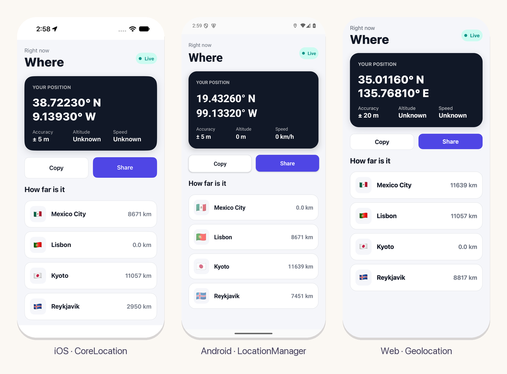

# location

Where the device is, for apps on [eskiu-lang/ui](https://github.com/eskiu-lang/ui). A
component calls `use_location` and gets the latest position while it is mounted; the platform's
own service measures it: CoreLocation on iOS, `LocationManager` on Android and
`navigator.geolocation` on the web. The first use asks the user for permission.



## Add it

In an app made with `ui new`:

```bash
eskiuc add location --git https://github.com/eskiu-lang/ui-location
```

The package brings what each platform needs through its `ui.toml`: the CoreLocation framework
and a usage text on iOS, the location permissions on Android. Put your own text in the app's
`ui.toml`, which wins over the package's:

```toml
[ios.plist]
NSLocationWhenInUseUsageDescription = "Shows the shops near you"
```

## Use it

```eskiu
import <location>;

void Here() {
    Location here = use_location(true);
    if (here.status == LocationReady) {
        String text;
        defer String_free(&text);
        String_format(&text, "%.5f, %.5f (± %.0f m)", here.latitude, here.longitude, here.accuracy);
        Text(text.data);
    } else if (here.status == LocationDenied) {
        Text("Allow the location in Settings");
    } else {
        ActivityIndicator(Style{}, true);
    }
}
```

| Name | What it is |
|---|---|
| `use_location(bool precise)` | The latest position while the scope is mounted; the scope renders again with each new one. The first component to mount starts the service and the last one to unmount stops it. `precise` asks for the device's best accuracy rather than about a hundred meters, which saves power. |
| `Location` | `status`, `latitude` and `longitude` (degrees), `accuracy` (meters), `has_altitude` and `altitude` (meters), `speed` (m/s) and `heading` (degrees from north, -1 when unknown), `time` (ms since 1970). |
| `LocationStatus` | `LocationWaiting` until the first position, then `LocationReady`, or `LocationDenied` (no permission) or `LocationUnavailable` (the service is off or cannot find the device). |
| `location_last()` | The latest position or failure, without subscribing. |
| `location_distance(a, b)` | The distance between two positions in meters, over the Earth's surface. |

## Platforms

| Platform | Service | Permission |
|---|---|---|
| iOS | `CLLocationManager`, best or hundred-meter accuracy | When in use, asked on first use |
| Android | `LocationManager`: GPS when precise and on, else the network's | `ACCESS_FINE_LOCATION` or `ACCESS_COARSE_LOCATION` at run time |
| Web | `navigator.geolocation.watchPosition` | The browser's prompt; it needs `https://` or `localhost` |

The native code is in `native/`: `ios/location.m`, `android/EskiuLocation.java` with
`android/location.c` (the externs, through JNI), and `web/location.js`.

## The example

`examples/where` shows the position, how precise it is and how far four cities are, with copy
and share:

```bash
cd examples/where
ui run ios        # or android, web
```

On a simulator or emulator, set a position:

```bash
xcrun simctl location booted set 19.4326,-99.1332
adb emu geo fix -99.1332 19.4326
```

## Tests

`eskiuc test` runs `tests/location.esk` on this computer, with stand-ins for the platform's
side that count their calls and the events a platform would send: one service for two
components, every field of a position, unknown altitude and speed, a denied permission, the
stop when the last component unmounts, and the distance from Paris to London.

## License

MIT
